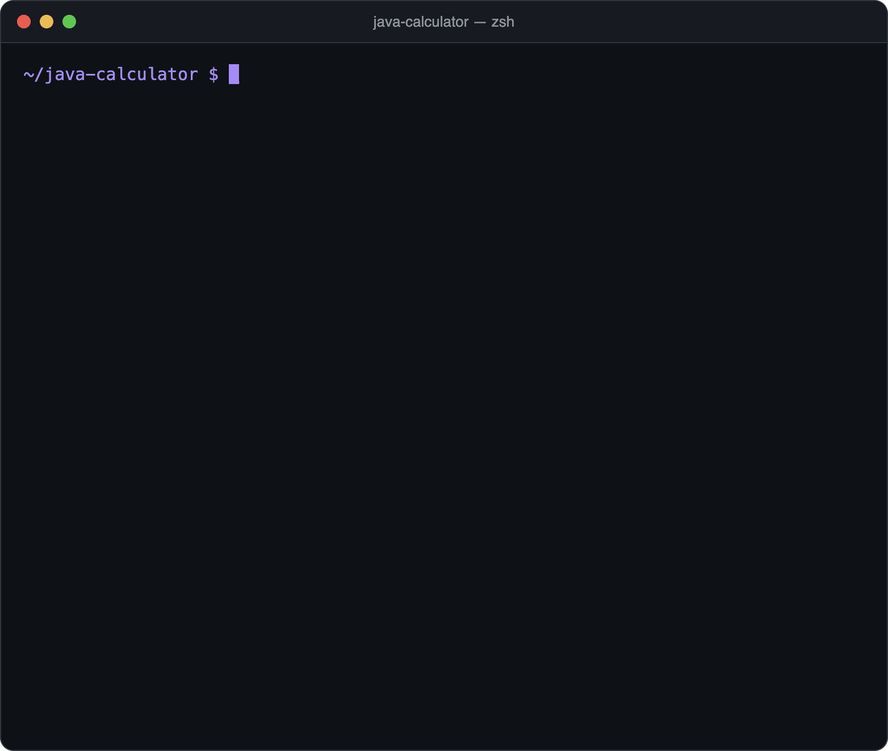

<div align="center">

# Calculator

A simple, robust console calculator in Java.




</div>

## Features

- Operators: `+` `-` `*` `/` `%` and power `^`
- Supports both decimal separators: `3.5` and `3,5` are both accepted
- Handles invalid input and division by zero without crashing
- Checks the operator right away, before asking for the second number
- Very large results are handled (e.g. `2 ^ 100`)
- Type `q` to quit

## Quick start

You only need a JDK (tested with Java 21). No build tool, no external libraries.

```bash
git clone https://github.com/meuselina/java-calculator.git
cd java-calculator

javac *.java
java Calculator       # calculator
java CalculatorTest   # 15 automated tests
```

## Example session

```
=== Calculator ===
Operators: +  -  *  /  %  ^
Type 'q' to quit.

First number: 2
Operator: ^
Second number: 10
Result: 2 ^ 10 = 1024

First number: 7,5
Operator: *
Second number: 4
Result: 7.5 * 4 = 30

First number: 9
Operator: /
Second number: 0
Error: Division by zero is not allowed.

First number: q
Goodbye.
```

```
$ java CalculatorTest
15 tests passed, 0 failed.
```

## Files

| File | Purpose |
|---|---|
| `Calculator.java` | Input loop, validation and the calculation itself |
| `CalculatorTest.java` | 15 automated tests, no test framework needed |

## Built with

Java, standard library only.

## License

[MIT](LICENSE) © 2026 Selina Meusel
